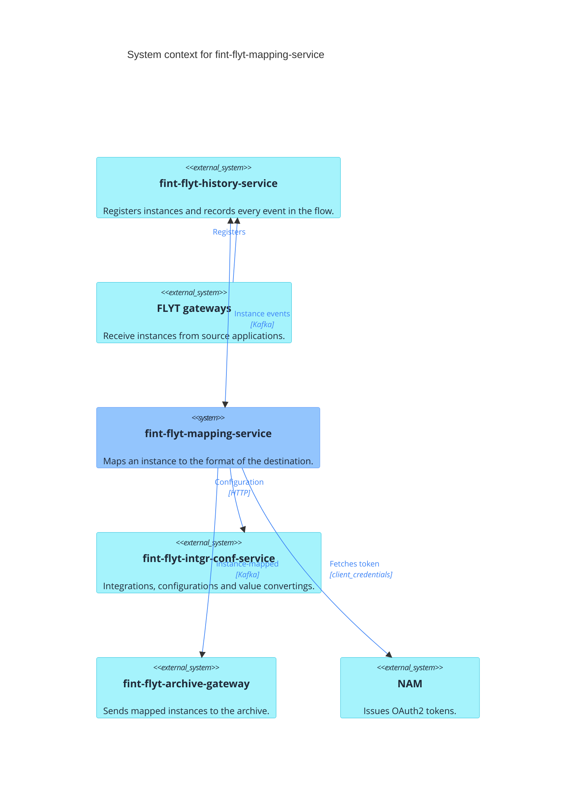
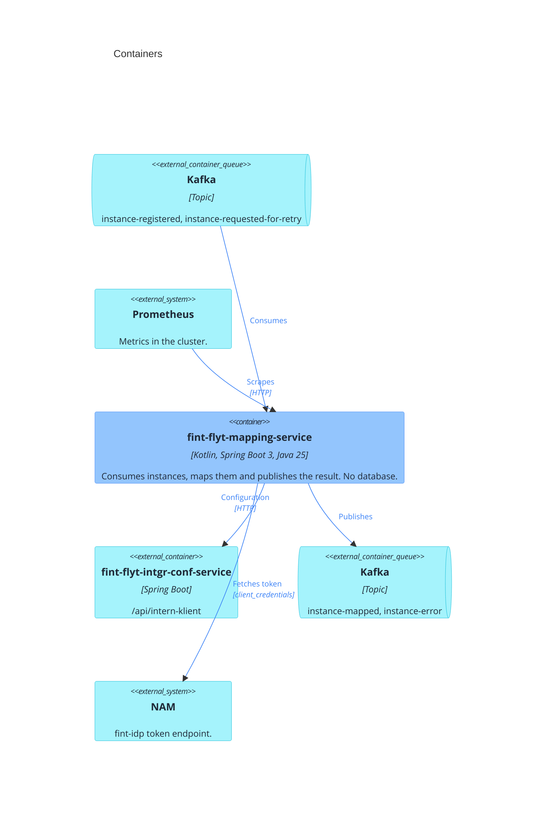
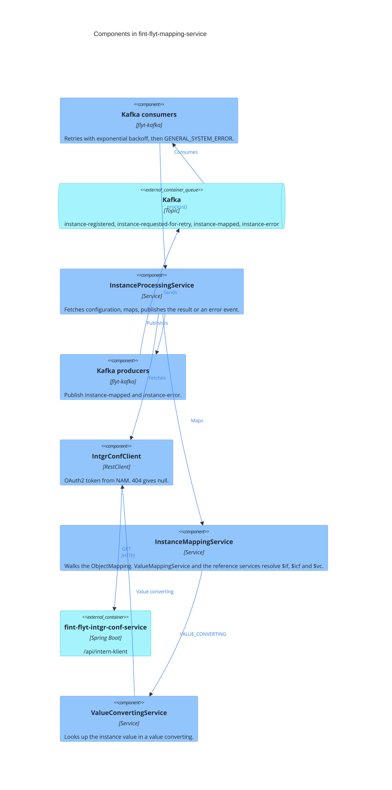

# Architecture

C4 level 1 to 3 for fint-flyt-mapping-service. Blue is this service, turquoise is external.

## C4 level 1: System context

A gateway registers an instance, this service maps it, and archive-gateway sends it to the archive.

`instance-registered` is still also produced by fint-flyt-instance-service, which is being merged
into history-service.

## C4 level 2: Containers

One Spring Boot application with no database. Everything it needs per instance is fetched from
intgr-conf-service.

## C4 level 3: Components

